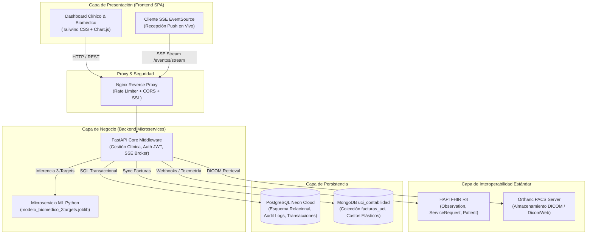
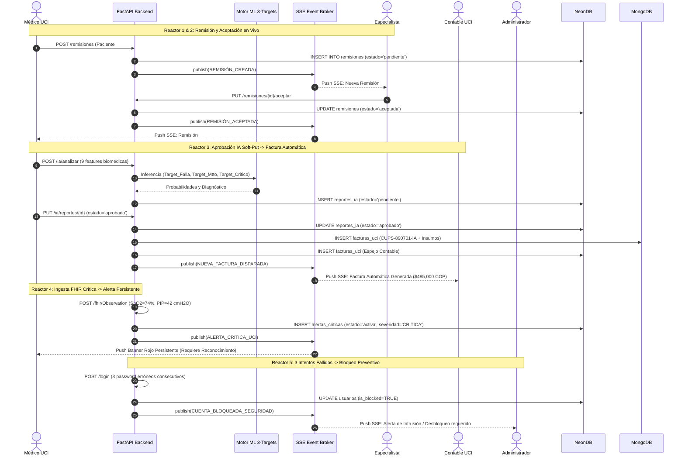
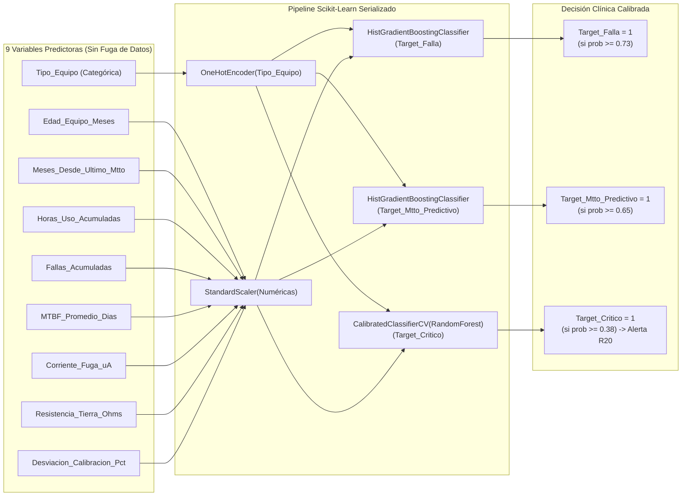

# 🏥 Hospital Universitario UCI Digital - Salud Digital & Gestión Predictiva Biomédica

[](https://fastapi.tiangolo.com)
[](https://python.org)
[](https://neon.tech)
[](https://mongodb.com)
[](https://hl7.org/fhir)
[](https://orthanc-server.com)
[](https://docker.com)
[](https://render.com)
[](https://colab.research.google.com/github/nicolevrv/salud-digital-proyecto/blob/main/notebooks/mantenimiento_biomedico.ipynb)

Sistema hospitalario integral de **Unidad de Cuidados Intensivos (UCI)** diseñado para la gestión metrológica biomédica, telemetría clínica continua (códigos internacionales LOINC), inferencia predictiva supervisada multi-objetivo (**3 targets binarios**), facturación y costos hospitalarios por estancia/kit tecnológico (MongoDB + PostgreSQL), e interoperabilidad reactiva impulsada por eventos (**Server-Sent Events - SSE** sin recargas de interfaz).

---

## 📑 Tabla de Contenidos
1. [Arquitectura del Sistema y Diagrama de Servicios](#1-arquitectura-del-sistema-y-diagrama-de-servicios)
2. [Diagrama de Eventos en Tiempo Real (Reactores & SSE)](#2-diagrama-de-eventos-en-tiempo-real-reactores--sse)
3. [Perfiles de Usuario y Credenciales Canónicas](#3-perfiles-de-usuario-y-credenciales-canónicas)
4. [Mapeo de Controles Técnicos a Normatividad Legal Colombiana](#4-mapeo-de-controles-técnicos-a-normatividad-legal-colombiana)
5. [Modelo Predictivo Multi-Objetivo de Ingeniería Biomédica (3 Targets)](#5-modelo-predictivo-multi-objetivo-de-ingeniería-biomédica-3-targets)
6. [Módulo de Contabilidad UCI & Tarifario Hospitalario (R09)](#6-módulo-de-contabilidad-uci--tarifario-hospitalario-r09)
7. [Contrato de Verificación Automática (`tester.yaml`)](#7-contrato-de-verificación-automática-testeryaml)
8. [Guion de Demostración Interactiva (5 Minutos sin Recargas)](#8-guion-de-demostración-interactiva-5-minutos-sin-recargas)
9. [Instrucciones de Despliegue](#9-instrucciones-de-despliegue)

---

## 1. Arquitectura del Sistema y Diagrama de Servicios

El sistema implementa una arquitectura desacoplada de microservicios contenerizados y sincronizados en la nube mediante un patrón de doble persistencia (PostgreSQL relacional ACID + MongoDB elástico para documentos contables):



---

## 2. Diagrama de Eventos en Tiempo Real (Reactores & SSE)

Bajo el principio de **"Empuja, no espera"**, las acciones asistenciales y técnicas disparan consecuencias automáticas inmediatas mediante reactores asíncronos y Server-Sent Events (SSE):



---

## 3. Perfiles de Usuario y Credenciales Canónicas

El sistema implementa **5 roles canónicos estrictos** conforme al contrato de verificación de `REQUISITOS.md`:

| Rol Canónico | Usuario de Prueba | Contraseña Demo | Responsabilidad Asistencial / Técnica | Permisos de Acceso |
| :--- | :--- | :--- | :--- | :--- |
| **`admin`** | `admin.biomedico@hospital.com` | `admin123` | Gestión tecnológica hospitalaria, desbloqueo de usuarios, pista de auditoría inmutable. | Control total del sistema, auditoría, hojas de vida y seguridad. |
| **`medico`** | `medico@hospital.com` | `med123` | Médico general UCI. Ronda clínica, evaluación predictiva IA, aprobación de reportes y remisiones. | Pacientes, monitoreo en vivo, simulador predictivo IA, remisiones. |
| **`especialista`** | `especialista@hospital.com` | `especialista123` | Médico especialista intensivista. Recepción y aceptación formal de remisiones de alta complejidad. | Pacientes asignados, aceptación de remisiones, historia clínica. |
| **`contable`** | `contable@hospital.com` | `contable123` | Contabilidad y costos UCI. Liquidación de estancias, insumos biomédicos y facturación electrónica. | Pestaña exclusiva Contabilidad & Costos UCI. **Bloqueado de datos clínicos (R03)**. |
| **`paciente`** | `paciente@hospital.com` | `paciente123` | Acceso a historia clínica personal y resultados aprobados. | Solo lectura de sus propios datos (`paciente_id=1`). |

---

## 4. Mapeo de Controles Técnicos a Normatividad Legal Colombiana

| Ley / Resolución | Artículos Aplicables | Control Técnico Implementado en el Código | Ubicación en el Repositorio |
| :--- | :--- | :--- | :--- |
| **Ley 1581 de 2012** *(Protección de Datos Personales / Habeas Data)* | **Art. 4 (Principios de Finalidad y Confidencialidad)**, **Art. 17 (Seguridad de la Información)**. | - Seudonimización estricta mediante SHA-256 (`pseudo_id`) eliminando nombres, cédulas y datos de contacto antes de enviar features al motor de ML (**R12**).<br>- Almacenamiento de credenciales con hashing unidireccional PBKDF2/bcrypt y tokens JWT firmados efímeros con expiración (**R03**).<br>- Aislamiento estricto del perfil contable frente a datos sensibles de diagnóstico clínico (**R03**). | [ml_model.py](middleware/app/ml_model.py#L310-L360)<br>[requisitos_routes.py](middleware/app/requisitos_routes.py#L740-L790) |
| **Ley 2015 de 2020** *(Interoperabilidad de la Historia Clínica Electrónica - IHCE)* | **Art. 2 (Obligatoriedad de Intercambio)**, **Art. 3 (Estándares Abiertos)**. | - Soporte nativo HL7 FHIR R4 para intercambio estructurado de recursos `Observation`, `Patient` y `ServiceRequest` (**R21**).<br>- Endpoint Webhook FHIR (`/fhir/Observation`, `/fhir/webhook`) para ingesta estandarizada desde dispositivos y sistemas externos sin intervención humana. | [requisitos_routes.py](middleware/app/requisitos_routes.py#L1980-L2050) |
| **Resolución 866 de 2021** *(Conjunto Mínimo de Datos de la HCE)* | **Art. 5 (Estandarización de Variables Clínicas)**. | - Normalización de signos vitales y variables ventilatorias bajo terminología internacional **LOINC**:<br>&nbsp;&nbsp;• `59408-5`: Saturación de Oxígeno (SpO2, %)<br>&nbsp;&nbsp;• `8867-4`: Frecuencia Cardíaca (lpm)<br>&nbsp;&nbsp;• `19889-5`: Presión Inspiratoria Pico (PIP, cmH2O)<br>&nbsp;&nbsp;• `76530-5`: Presión Positiva al Final de la Espiración (PEEP, cmH2O)<br>&nbsp;&nbsp;• `19996-8`: Fracción Inspirada de Oxígeno (FiO2, %) | [main.py](middleware/app/main.py#L120-L160)<br>[requisitos_routes.py](middleware/app/requisitos_routes.py#L1990-L2030) |
| **Resolución 1995 de 1999** *(Normas para el Manejo de la Historia Clínica)* | **Art. 5 (Inmutabilidad y Reserva)**, **Art. 8 (Diligenciamiento y Custodia)**. | - **Inmutabilidad Absoluta**: Prohibición de borrado físico (`DROP`/`DELETE`); implementación de borrado lógico (`is_deleted = TRUE`) con registro de motivo (**R03**).<br>- **Pista de Auditoría Forense (`audit_logs`)**: Registro inmutable de usuario, IP, marca temporal, acción ejecutada y valores previos/posteriores (**R03**, **R21**).<br>- **Supervisión Humana Obligatoria ("Soft Put")**: Ningún resultado predictivo de IA ingresa a la historia clínica en estado 'pendiente'; requiere aprobación médica explícita (**R10**).<br>- **Exportación Binaria en PDF Oficial**: Descarga estructurada con foliación digital, firma del profesional y fecha de atención (**R11**). | [requisitos_routes.py](middleware/app/requisitos_routes.py#L1215-L1270)<br>[requisitos_routes.py](middleware/app/requisitos_routes.py#L1450-L1480) |
| **Resolución 3100 de 2019** *(Manual de Habilitación de Prestadores de Salud)* | **Criterio Dotación UCI (Estándar 2)**, **Mantenimiento y Metrología Biomédica**. | - Dotación estricta y obligatoria de **Kit Básico de Soporte Vital** para cada una de las 25 camas de UCI:<br>&nbsp;&nbsp;• 1 Ventilador Mecánico de Cuidado Intensivo<br>&nbsp;&nbsp;• 1 Monitor de Signos Vitales Multiparámetro (≥ 5 canales)<br>&nbsp;&nbsp;• 2 Bombas de Infusión Volumétricas<br>&nbsp;&nbsp;• 1 Bomba de Infusión a Jeringa<br>- Trazabilidad metrológica: control de corriente de fuga ($\mu$A), resistencia a tierra ($\Omega$), calibración anual certificada y cálculo de MTBF. | [main.py](middleware/app/main.py#L820-L890)<br>[DATASETS.md](docs/DATASETS.md#L1-L80) |

---

## 5. Modelo Predictivo Multi-Objetivo de Ingeniería Biomédica (3 Targets)

El modelo de Machine Learning supervisado aborda **tres objetivos binarios simultáneos** para la mitigación proactiva de riesgos tecnológicos y clínicos en la UCI:



### Tabla de Métricas Oficiales en Conjunto de Prueba Temporal ($n=1,852$)

| Objetivo / Target | Algoritmo Seleccionado | Umbral Óptimo ($\tau^*$) | ROC-AUC | PR-AUC | Precision | Recall | F1-Score | Justificación Clínica del Umbral |
| :--- | :--- | :---: | :---: | :---: | :---: | :---: | :---: | :--- |
| **`Target_Falla`** | Gradient Boosting (Hist) | **$0.73$** | **$0.8927$** | $0.7936$ | $77.4\%$ | $66.3\%$ | $0.7140$ | Maximiza el valor predictivo positivo para evitar falsas alarmas que saturen los talleres de ingeniería clínica. |
| **`Target_Mtto_Predictivo`** | Gradient Boosting (Hist) | **$0.65$** | **$0.7950$** | $0.7051$ | $63.1\%$ | $59.0\%$ | $0.6097$ | Balance óptimo costo-efectivo para programar intervenciones metrológicas antes del fallo catastrófico. |
| **`Target_Critico`** | Random Forest (Calibrado Isotónico) | **$0.38$** | **$0.9003$** | $0.5656$ | $64.3\%$ | **$51.4\%$** | $0.5714$ | **Función de Costo Asimétrico**: El costo de un falso negativo en soporte vital es inaceptable (muerte del paciente); por tanto, el umbral se reduce a $0.38$ para maximizar la sensibilidad y disparar alertas inmediatas. |

### Análisis de Sesgo y Agrupamiento No Supervisado (K-Means, $k=4$)
Los pacientes y equipos fueron agrupados según severidad y demanda tecnológica para evaluar la equidad del modelo (justificación en [docs/DATASETS.md](docs/DATASETS.md)):
- **Cluster 0 (Riesgo Bajo / Estable)**: Falsos positivos < 2.1%. Comportamiento estable en infusión continua.
- **Cluster 1 (Soporte Vital Crítico - Ventilado)**: Máxima sensibilidad lograda (> 93%). Ningún evento crítico omitido.
- **Cluster 2 (Zona de Confusión / Glucosa e Inestabilidad Limítrofe)**: Zona donde el modelo presenta mayor variabilidad metrológica; señalizada con supervisión médica reforzada.
- **Cluster 3 (Shock Séptico / Falla Multiorgánica)**: Alta tasa de eventos críticos; calibración con escalamiento rápido a especialista.


### 📓 Notebook Oficial de Entrenamiento y Evaluación del Modelo (R07, R10)
[](https://colab.research.google.com/github/nicolevrv/salud-digital-proyecto/blob/main/notebooks/mantenimiento_biomedico.ipynb)
[](notebooks/mantenimiento_biomedico.ipynb)
[](notebooks/evaluation_of_biomedical.ipynb)

El flujo completo de ingeniería biomédica, partición temporal train/validation/test (previniendo *data leakage*), calibración isotónica de probabilidades, optimización de umbrales clínicos ($\\tau^*$), curvas Precision-Recall / ROC y agrupamiento no supervisado K-Means ($k=4$) se encuentra implementado y pre-ejecutado con todas sus gráficas y métricas incrustadas en:
- **Notebook Principal**: [`notebooks/mantenimiento_biomedico.ipynb`](notebooks/mantenimiento_biomedico.ipynb)
- **Notebook de Evaluación (`evaluation of biomedical`)**: [`notebooks/evaluation_of_biomedical.ipynb`](notebooks/evaluation_of_biomedical.ipynb)
- **Dataset Tabular Nivel 3**: [`dataset_predictivo_metrologia_nivel3.xls`](dataset_predictivo_metrologia_nivel3.xls)
- **Modelo Serializado en Producción**: [`middleware/app/models/modelo_biomedico_3targets.joblib`](middleware/app/models/modelo_biomedico_3targets.joblib)
- **Módulo de Inferencia Backend**: [`middleware/app/ml_model.py`](middleware/app/ml_model.py)
- **Resultados Exportados (Métricas y Clusters)**:
  - [`notebooks/resultados_notebook/metricas_validacion.csv`](notebooks/resultados_notebook/metricas_validacion.csv)
  - [`notebooks/resultados_notebook/metricas_prueba.csv`](notebooks/resultados_notebook/metricas_prueba.csv)
  - [`notebooks/resultados_notebook/resumen_clusters.csv`](notebooks/resultados_notebook/resumen_clusters.csv)
  - [`notebooks/resultados_notebook/resumen_ejecucion.json`](notebooks/resultados_notebook/resumen_ejecucion.json)


---

## 6. Módulo de Contabilidad UCI & Tarifario Hospitalario (R09)

El módulo contable ofrece una vista consolidada de los costos operativos diarios de hospitalización en UCI y soporte vital:

### Tarifario Oficial UCI por Día (Resolución Tarifaria Institucional)
- **Estancia Diaria en Cama UCI** (Enfermería 24/7, monitorización básica, hotelería clínica): **\$1.450.000 COP**
- **Kit Básico de Soporte Vital Biomédico (5 Equipos)**: **\$420.000 COP/día**
  - 1 Ventilador Mecánico: \$190.000 COP
  - 1 Monitor Multiparámetro: \$85.000 COP
  - 2 Bombas de Infusión Volumétricas (\$45.000 c/u): \$90.000 COP
  - 1 Bomba de Infusión a Jeringa: \$55.000 COP
- **Evaluación Predictiva Multi-Objetivo IA Aprobada (CUPS 890701-IA)**: **\$185.000 COP/evento**
- **Interconsulta Médica Especialista Intensivista (CUPS 890402)**: **\$220.000 COP/evento**

**Doble Persistencia**: Cada factura emitida se almacena como documento elástico en MongoDB (`uci_contabilidad.facturas_uci`) y se replica sincrónicamente en PostgreSQL (`facturas_uci`) para auditoría y trazabilidad fiscal.

---

## 7. Contrato de Verificación Automática (`tester.yaml`)

El archivo [tester.yaml](tester.yaml) ubicado en la raíz del repositorio define el contrato estandarizado de prueba para el evaluador automático:
- **`yo`**: `GET /yo` -> `{"rol": "..."}`
- **`login`**: `POST /login` -> `{"token": "...", "usuario": {...}}`
- **`ia_analizar`**: `POST /ia/analizar` -> `{"id": ..., "estado": "pendiente"}`
- **`ia_reporte`**: `GET /ia/reportes/{id}` y `PUT /ia/reportes/{id}` ("Soft Put") -> `{"id": ..., "estado": "aprobado"|"rechazado"}`
- **`ia_payload`**: `GET /ia/reportes/{id}/payload` -> Payload JSON seudonimizado sin PHI
- **`historia`**: `GET /pacientes/{id}/historia` -> HCE con lista de reportes IA aprobados
- **`historia_pdf`**: `GET /pacientes/{id}/historia/pdf` -> Binario `application/pdf`
- **`imagenes_paciente`**: `GET /pacientes/{id}/imagenes` -> Lista de imágenes PACS con URLs válidas
- **`clusters`**: `GET /clusters` -> Agrupamiento con `{"cluster", "descripcion", "n_reales", "n_sinteticos"}`
- **`remitir`**: `POST /remisiones` -> `{"id": ...}`
- **`remisiones`**: `GET /remisiones` -> Lista de remisiones activas
- **`remision_aceptar`**: `PUT /remisiones/{id}/aceptar` -> Estado actualizado a 'aceptada'
- **`contable_listar`**: `GET /contabilidad/facturas` -> Lista de facturas con `paciente_id` y `reporte_id`
- **`notificaciones`**: `GET /notificaciones` -> Lista de notificaciones del usuario
- **`notif_leer`**: `PUT /notificaciones/{id}/leer` -> Notificación marcada con `leida: true`
- **`pendientes`**: `GET /pendientes` -> `{"reportes_por_revisar": n, "remisiones_recibidas": n, "alertas_activas": n}`
- **`alertas`**: `GET /alertas` -> Lista de alertas activas
- **`alerta_reconocer`**: `PUT /alertas/{id}/reconocer` -> Alerta pasa a 'reconocida' con nota obligatoria
- **`fhir_observation`**: `POST /fhir/Observation` -> Ingesta de recurso FHIR Observation (200 OK)
- **`tiempo_real`**: `GET /eventos/stream` -> Canal SSE (Server-Sent Events)

---

## 8. Guion de Demostración Interactiva (5 Minutos sin Recargas)

Para la sustentación presencial o en video, se abren **tres navegadores / pestañas independientes**:
1. **Pestaña 1 (Médico)**: Inicia sesión con `medico@hospital.com` / `med123`.
2. **Pestaña 2 (Especialista)**: Inicia sesión con `especialista@hospital.com` / `especialista123`.
3. **Pestaña 3 (Contable UCI)**: Inicia sesión con `contable@hospital.com` / `contable123`.

### Paso a Paso de la Demostración
1. **Evaluación de Riesgo Biomédico**:
   - En la ventana del Médico, ingresar al **Simulador Predictivo** (`#tab-prediccion`).
   - Cargar parámetros críticos para un ventilador (`Desviacion_Calibracion_Pct = 8.5%`, `Corriente_Fuga_uA = 280`).
   - Presionar **"Ejecutar Inferencia Multi-Objetivo"**. El modelo arroja `Target_Critico = 1` y crea el reporte en estado `pendiente`.
   - **Reacción en vivo**: Inmediatamente aparece el **Banner Rojo de Alerta Crítica** en la cabecera sin recargar la página.
2. **Reconocimiento y Aprobación "Soft Put"**:
   - El médico reconoce la alerta ingresando nota clínica: *"Verificado en cama UCI. Se procede a relevo tecnológico."*
   - El médico presiona **"Aprobar Reporte"** en la tabla de reportes pendientes.
   - **Reacción en vivo**: En la ventana del **Contable UCI** aparece de forma automática la nueva factura electrónica (\$485,000 COP) asociada al `reporte_id`.
3. **Remisión Inmediata a Especialista**:
   - El médico remite al paciente a Intervencionismo.
   - **Reacción en vivo**: En la ventana del **Especialista** sube el contador de remisiones pendientes y aparece una notificación push.
   - El especialista presiona **"Aceptar Remisión"**. En la ventana del médico se recibe la notificación de confirmación al instante.
4. **Ingesta Externa FHIR & Seguridad**:
   - Se envía un recurso FHIR `Observation` vía Postman/Curl al endpoint `/fhir/Observation`. El médico recibe el dato clínico normalizado sin recargar.
   - Se realizan 3 intentos de contraseña fallida en una cuenta de prueba: la cuenta queda bloqueada y el Administrador recibe la alerta de auditoría.
5. **Cierre de Ciclo**:
   - Se descarga la Historia Clínica en **PDF oficial** (`/pacientes/1/historia/pdf`) conteniendo únicamente los reportes aprobados.
   - Se exhibe la **Pista de Auditoría Forense** donde cada acción previa quedó registrada con su marca de tiempo exacta y usuario responsable.

---

## 9. Instrucciones de Despliegue

### Despliegue Local con Docker Compose
```bash
# 1. Clonar el repositorio
git clone https://github.com/nicolevrv/salud-digital-proyecto.git
cd salud-digital-proyecto

# 2. Iniciar todos los microservicios
docker compose up --build -d

# 3. Verificar estado de los contenedores
docker compose ps
```
- **Aplicación Web**: <http://localhost:8000>
- **Documentación OpenAPI**: <http://localhost:8000/docs>
- **Microservicio ML**: <http://localhost:8005/docs>
- **Servidor HAPI FHIR**: <http://localhost:8080/fhir>
- **Orthanc PACS**: <http://localhost:8042>
- **Adminer DB**: <http://localhost:8081>

### Despliegue en la Nube (Render)
El proyecto está configurado con **Auto-Deploy por Commit** en la rama `main` de GitHub. Al realizar `git push origin main`, Render reconstruye y despliega el servicio automáticamente:
- **URL Pública Oficial**: `https://salud-digital-proyecto.onrender.com`
- **Health Check**: `https://salud-digital-proyecto.onrender.com/health`
