# Arquitectura Reactiva, Eventos en Tiempo Real (SSE) y Escalamiento de Alertas · R16–R21

Este documento describe el sistema de eventos en tiempo real (**Server-Sent Events — SSE**), la bandeja persistente de notificaciones, los **cuatro flujos reactivos automáticos (R19)**, la gestión de **alertas críticas con reconocimiento obligatorio (R20)** y el **webhook reactivo HL7 FHIR (R21)**.

---

## 1. Canal de Eventos en Tiempo Real (`GET /eventos/stream`) · R17

El backend expone un canal persistente **Server-Sent Events (`text/event-stream`)** en `/eventos/stream` (autenticado mediante token de sesión en cabecera `Authorization: Bearer <token>`, `X-Session-Token` o parámetro `?token=<token>`).

- **Infraestructura sin Buffering (R05)**: El proxy inverso `nginx` incluye `proxy_buffering off; proxy_cache off; chunked_transfer_encoding off;` en la ruta `/eventos/stream` y la API emite la cabecera `X-Accel-Buffering: no`.
- **Filtrado por Rol (RBAC en vivo)**: Cada conexión SSE queda suscrita únicamente a los eventos pertinentes al rol del usuario autenticado (`medico`, `especialista`, `contable`, `admin`), evitando fugas de información clínica hacia perfiles administrativos o contables.

### Esquema Estándar de Evento Emitido (`JSON`)
```json
{
  "id": 42,
  "tipo": "ALERTA_CRITICA_UCI",
  "mensaje": "Evento crítico detectado en Cama 1 - UCI Adultos (VENT-01: Target_Critico=1, Gravedad >= 8)",
  "fecha": "2026-10-19T02:10:00",
  "paciente_id": 1,
  "equipo_id": "VENT-01",
  "rol_destino": "medico",
  "referencia_id": 15,
  "severidad": "CRITICA"
}
```

---

## 2. Los 4 Flujos Reactivos Automáticos · R19

Cada acción de negocio dispara de forma atómica y sin intervención manual la cadena completa: **persistencia en base de datos + registro en tabla `notificaciones` + emisión inmediata por SSE + registro en `audit_logs`**.

```mermaid
flowchart TD
    subgraph Flujo1["1. Remisión Clínica/Biomédica (R08 → R19)"]
        M1["Médico crea remisión (POST /remisiones)"] --> DB1["Guarda remisión (estado: pendiente) + FHIR ServiceRequest"]
        DB1 --> N1["Crea notificación para rol: especialista"]
        N1 --> SSE1["Emite evento SSE REMISION_NUEVA al Especialista"]
    end

    subgraph Flujo2["2. Aceptación de Remisión (R08 → R19)"]
        E2["Especialista acepta remisión (PUT /remisiones/{id}/aceptar)"] --> DB2["Actualiza remisión (estado: aceptada)"]
        DB2 --> N2["Crea notificación para el Médico remitente"]
        N2 --> SSE2["Emite evento SSE REMISION_ACEPTADA al Médico"]
    end

    subgraph Flujo3["3. Aprobación de Reporte IA y Facturación Automática (R10 → R09/R19)"]
        D3["Médico/Especialista aprueba reporte IA (PUT /ia/reportes/{id})"] --> DB3["Reporte pasa a estado: aprobado (visible en Historia y PDF)"]
        DB3 --> F3["Crea factura automática en MongoDB/PostgreSQL con reporte_id"]
        F3 --> N3["Crea notificación para rol: contable"]
        N3 --> SSE3["Emite evento SSE FACTURA_GENERADA_IA al Contable"]
    end

    subgraph Flujo4["4. Bloqueo de Cuenta por Intentos Fallidos (R02 → R19)"]
        L4["3 intentos fallidos de login en /login"] --> DB4["Bloquea cuenta 15 min (locked_until) + login_logs (LOCKED)"]
        DB4 --> N4["Crea notificación de seguridad para rol: admin"]
        N4 --> SSE4["Emite evento SSE CUENTA_BLOQUEADA al Administrador"]
    end
```



### Detalle de los 4 Reactores

| # | Evento Disparador | Origen | Acción Reactiva Automática | Destinatario SSE y Bandeja |
| :-: | :--- | :--- | :--- | :--- |
| **1** | Creación de remisión (`POST /remisiones`) | `medico` | Registra la remisión en estado `pendiente`, sincroniza `ServiceRequest` en HAPI FHIR, incrementa `remisiones_recibidas` en `/pendientes` y notifica al especialista. | `especialista` |
| **2** | Aceptación de remisión (`PUT /remisiones/{id}/aceptar`) | `especialista` | Cambia estado a `aceptada`, adjunta dictamen técnico/clínico y notifica en vivo al médico que originó la remisión. | `medico` |
| **3** | Aprobación de reporte IA (`PUT /ia/reportes/{id}` con `estado="aprobado"`) | `medico` o `especialista` | Incorpora el diagnóstico de los 3 targets (`Target_Falla`, `Target_Mtto_Predictivo`, `Target_Critico`) a la historia clínica y **crea automáticamente una factura en `MongoDB` (`facturas_uci`) con `reporte_id`** asociado. | `contable` |
| **4** | Tres (3) intentos fallidos de inicio de sesión (`POST /login`) | Cualquier usuario/IP | Bloquea la cuenta por 15 minutos (`403 Forbidden`), registra el evento `LOCKED` en `login_logs` y alerta inmediatamente al administrador. | `admin` |

---

## 3. Alertas Críticas con Reconocimiento Obligatorio y Escalamiento · R20

### 3.1. Generación de la Alerta Crítica
Una alerta crítica (`estado = "activa"`) se dispara automáticamente en cualquiera de los siguientes escenarios:
1. **Modelo Predictivo Multi-Objetivo (Target 3)**: Cuando la inferencia del modelo arroja **`Target_Critico = 1`** (`probabilidad >= 0.38`, correspondiente a `Gravedad_Evento >= 8` en equipos de soporte vital UCI).
2. **Telemetría / Observación Clínica o Webhook FHIR Crítico**: Cuando ingresa una medición LOINC o parámetro IEC 62353 fuera de umbral seguro (por ejemplo, `SpO2 < 88%`, `Presión Pico > 40 cmH2O`, `Glucosa > 250 mg/dL` o ` < 55 mg/dL`, `Corriente de Fuga > 150 µA`).

### 3.2. Reconocimiento Obligatorio con Nota Clínica/Técnica
- Mientras la alerta permanezca en `estado = "activa"`, se contabiliza en `GET /pendientes` (`alertas_activas > 0`) y se muestra en un **banner rojo persistente** en la parte superior del dashboard.
- Una alerta crítica **no puede cerrarse como una notificación común**: requiere invocar `POST /alertas/{id}/reconocer` (o `PUT /alertas/{id}/reconocer`) por parte de un `medico` o `especialista` incluyendo obligatoriamente una **`nota` no vacía** con la acción correctiva tomada.
- Al reconocerse:
  1. Su estado pasa de `activa` a `reconocida`.
  2. Se almacena el usuario responsable, la marca de tiempo y la nota clínica/técnica.
  3. Se escribe un registro inmutable en `audit_logs` (`RECONOCER_ALERTA_CRITICA`).

### 3.3. Regla de Escalamiento por Tiempo de Respuesta
El sistema evalúa la antigüedad de toda alerta crítica en `estado = "activa"`:
- **Nivel 1 (`0 a 5 minutos`)**: Alerta activa asignada al `medico` de turno en UCI y al `especialista` de soporte vital en cama.
- **Nivel 2 (`5 a 15 minutos sin reconocimiento`)**: La alerta se marca con prioridad `ESCALADA_ESPECIALISTA`, re-emitiendo pulso SSE prioritario a todos los ingenieros clínicos (`ING_CORRECTIVO` / `especialista`).
- **Nivel 3 (`> 15 minutos sin reconocimiento`)**: La alerta escala automáticamente a la **Dirección Biomédica y Administración (`admin`)**, generando una notificación de incumplimiento de SLA crítico en UCI.

---

## 4. Webhook Reactivo con HAPI FHIR · R21

El endpoint `POST /fhir/webhook` (y su alias compatible `POST /fhir/Observation`) recibe recursos estándar **HL7 FHIR R4 `Observation`** (por ejemplo, glucemia LOINC `2339-0`, saturación de oxígeno `59408-5` o presión inspiratoria `19994-3`):

1. Extrae el código LOINC (`code.coding[0].code`), el valor numérico (`valueQuantity.value`), la unidad y la referencia al paciente (`subject.reference`, ej. `"Patient/1"`).
2. Persiste la observación en la base de datos clínica vinculada al encuentro activo del paciente en UCI.
3. Si el valor supera umbrales críticos, crea una alerta crítica activa (**R20**).
4. Emite en tiempo real por **SSE** (`OBSERVACION_FHIR_RECIBIDA`) la notificación al médico responsable y registra el evento en `audit_logs` con `origen = "FHIR"`.
